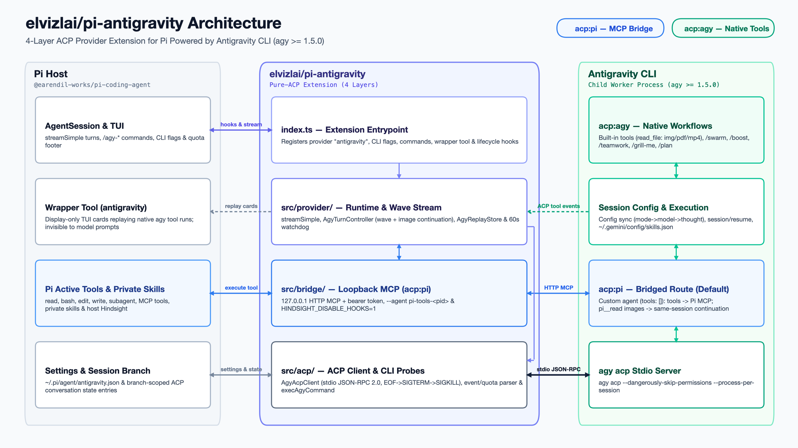

# elvizlai/pi-antigravity

Clean 4-layer ACP [Pi](https://github.com/earendil-works/pi) provider extension powered directly by `agy acp` (`agy >= 1.5.0`).

Communicates over Antigravity CLI's public stdio JSON-RPC Agent Client Protocol (`agy acp --dangerously-skip-permissions --process-per-session`).

## Architecture



- `src/acp/` — Shared type/abort helpers (`shared.ts`), process-group cleanup & detached one-shot CLI runner (`process-tree.ts`), binary verification (`agy >= 1.5.0`), ACP JSON-RPC 2.0 client transport (per-RPC abort/stall timeouts & 3-stage `stdin EOF -> SIGTERM -> SIGKILL` disposal), protocol event normalization, model discovery & config planning, `/usage` quota fetching/formatting, and quota/stop-reason classification.
- `src/bridge/` — Localhost HTTP MCP server bridging Pi active tools & Pi-private skills (`pi__activate_skill`), `--agent` lifecycle helpers, and automatic `HINDSIGHT_DISABLE_HOOKS=1` propagation when Pi's Hindsight extension is active (preventing duplicate prompt injection and double session write-back).
- `src/provider/` — Extension settings (`~/.pi/agent/antigravity.json`), session-branch persistence, transcript prompt/system extraction (`getCurrentSystemMessage`), inline bridged tool-image continuation (`splitToolResultImages` / `buildToolImageContinuationPrompt`), wave turn controller + replay store, runtime & first-response stall watchdog, Pi `streamSimple` adapter, and TUI card rendering.
- `index.ts` — Thin Pi extension entrypoint registering provider `"antigravity"` (with `refreshModels` & `streamSimple`), flags, display-only `antigravity` wrapper tool, commands, and session hooks.

## Requirements

- Node.js `>= 22.18.0`
- Antigravity CLI (`agy`) `>= 1.5.0`

## Installation

Add the package to `~/.pi/agent/settings.json`, then restart Pi or run `/reload`:

```json
{
  "packages": ["git:github.com/elvizlai/pi-antigravity"]
}
```

## Tool Modes & Settings

Extension settings are stored independently in `~/.pi/agent/antigravity.json` (never modifying Pi's `settings.json`):

| Aspect               | `pi` (`acp:pi`, default)                                                                                                                                                                                                                               | `agy` (`acp:agy`)                                                                                                                                       |
| -------------------- | ------------------------------------------------------------------------------------------------------------------------------------------------------------------------------------------------------------------------------------------------------ | ------------------------------------------------------------------------------------------------------------------------------------------------------- |
| **Tools**            | `agy` built-in tools disabled (`"tools": []`); Pi active tools (`read`, `bash`, `edit`, `write`, `codemode`, `subagent`, MCP tools) + Pi-private skills (`pi__activate_skill`) are bridged via `--agent pi-tools-<pid>` and a loopback HTTP MCP server | `agy` executes its own built-in tools, skills, and workflows directly (`/swarm`, `/boost`, `/teamwork`, `/grill-me`, `/learn`, `/plan`, `run_workflow`) |
| **Execution & TUI**  | Tools execute inside Pi with Pi permissions, hooks, `<read-files>` tracking, and native Pi TUI cards                                                                                                                                                   | Tools and multi-agent pipelines execute inside `agy`; Pi displays a summary card                                                                        |
| **Multimodal files** | `pi__read` images are forwarded inline on a same-session `session/prompt` continuation; non-image files (e.g. PDF/MP4) are not natively read by `agy`                                                                                                  | `agy`'s native `read_file` handles images, PDFs, audio, and video directly                                                                              |

- Multi-agent background pipelines in `agy` mode (`/swarm`, `/boost`, `/teamwork`) require a persistent session (interactive TUI or `pi --mode rpc`) across turns; Pi's built-in `/compact` (and extension commands such as `/goal` if installed) take precedence locally before prompts reach `agy acp`.
- `agy` only discovers Antigravity skill directories by default; if you want `acp:agy` to also see shared skills in `~/.agents/skills`, add `"~/.agents/skills"` to `~/.gemini/config/skills.json` (`additionalPaths`).

## Timeouts & Failure Handling

- **First-event watchdog (`60s` default)**: covers both handshake/session setup (`initialize`, `newSession` / `resumeSession`, `setConfigOption`) and pre-first-event `session/prompt`, clearing immediately once any thinking, text, or tool/subagent activity begins — so subagents and long-running tasks have no time limit. If `agy acp` stalls for 60 seconds before emitting an initial event, the runtime cancels and disposes the stalled worker cleanly.
- **Explicit quota & terminal stop reasons**: quota exhaustion (`Antigravity quota exceeded`), `max_turn_requests`, and `refusal` fail fast without retries.

## Commands & Flags

- `/agy-tools [pi|agy]` — Switch or inspect tool routing (persists to `~/.pi/agent/antigravity.json`)
- `/agy-plan [on|off]` — Toggle ACP `plan` execution mode vs `default`
- `/agy-reset` — Reset the bound ACP conversation and start fresh on the next turn
- `/agy-doctor` — Verify `agy >= 1.5.0`, bridge server state, ACP connection, and quota status
- `/agy-models` — Refresh available models from `agy models`
- `/agy-usage` — Show Antigravity 5-hour and weekly model quotas (progress bars & reset times)

CLI flags: `--agy-tools pi|agy`, `--agy-plan`, `--agy-sandbox`, `--agy-add-dir dir1,dir2`.

## Development

```bash
npm install
npm run check
npm test
```
